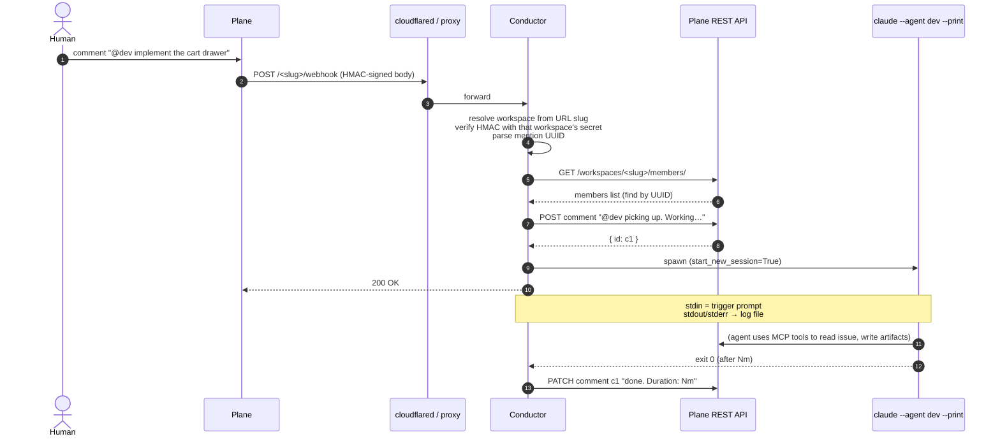
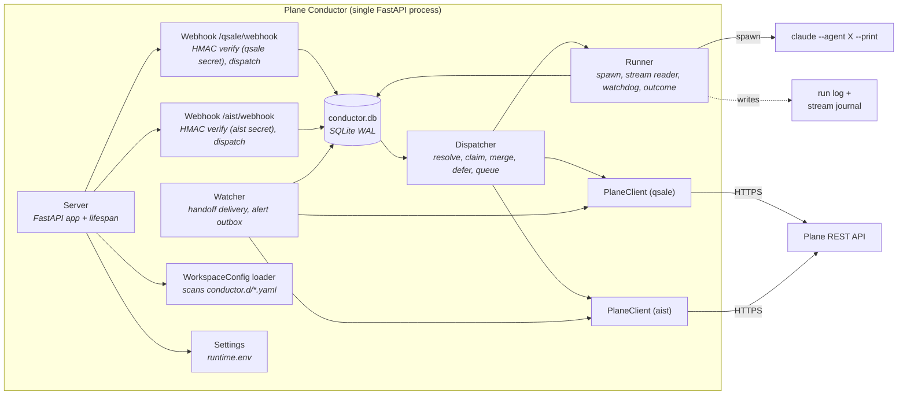

# Architecture

Plane Conductor is a single-process FastAPI service that translates Plane
webhooks into local `claude` subprocesses, supervises them to completion,
and reports outcomes back into Plane.

It holds **no persistent state**. Everything it remembers is what's
currently running (in three small in-memory sets) plus per-run log files
on disk. That's it.

It serves **N workspaces from one process** (nginx-vhost style): each
workspace is one self-contained YAML in `conductor.d/` with its own Plane
creds, project, agents, and webhook secret. The webhook is dispatched by
URL path: `POST /<workspace_slug>/webhook`.

---

## What happens when you mention an agent

Sequence diagram of one mention, end-to-end:



Key points:

- The webhook handler returns **200 immediately** after spawning. The
  agent's actual work runs in a supervisor task; Plane is not kept
  waiting on a long-lived HTTP request.
- The `picking up…` comment is posted *before* the subprocess inherits
  control, so the human sees instant feedback even if the agent itself is
  slow to produce output.
- That same comment is **updated** when the agent exits (success → done +
  duration; non-zero → error + duration). The conductor never posts a
  separate "failed" note when the announce flow is on; it edits the
  existing one.
- HMAC verification is **per workspace**: each workspace has its own
  secret in its YAML, so a leaked secret only compromises one tenant.

---

## Internal components



### Server (`server.py`)

FastAPI app factory. On startup it loads every `*.yaml` in
`settings.conductor_dir` into a `dict[slug, WorkspaceConfig]`, builds one
`PlaneClient` per workspace, mounts a `/<slug>/webhook` route per
workspace, and exposes `GET /health` (which lists the loaded slugs and where each
workspace's credentials were read from — `file` or `inline`, never the values).
The `lifespan` runs [restart recovery](#restart-recovery) on startup and
waits for in-flight agents on shutdown (with a configurable grace
window), then closes every `PlaneClient`.

### Webhook receiver (`webhook.py`)

One route per workspace, mounted as `POST /<slug>/webhook`. It is **thin and
durable-first**: Plane retries only *transport* failures of a delivery (never a
non-2xx answer), so the receiver makes no Plane call on the request path.

1. Constant-time HMAC-SHA256 verification of the raw body against
   that workspace's `webhook_secret`.
2. Parse JSON; ignore everything except `issue_comment` events with
   `created` or `updated` action.
3. Hand gates / role handoffs to the workbench notifier (unchanged).
4. For every mentioned member (the initiator is skipped) `INSERT OR IGNORE` one
   `triggers` row, unique on `(comment_id, member_uuid)`: a redelivered webhook, or an
   edit that adds no addressee, creates nothing; an edit that adds one creates one. An
   initiator reply with no mention becomes an `auto_resume` row.
5. Wake the Dispatcher and answer `200` ("durably accepted"). A failed write answers
   `503` and logs `state_write_failed`.

### Dispatcher (`dispatcher.py`)

The single task that turns accepted triggers into runs. It resolves member →
nickname (allow-list), the **root issue** (top-level ancestor, so a sub-issue and its
root share a key) and the **source run** of the trigger (the run whose tower call created
the comment, read from the agent's stream). Then, per trigger and in one transaction:

| Situation | Result |
|---|---|
| source run already covered by the key's slot (or an earlier trigger of the same effect) | `merged` — no second process (COINEX-184) |
| a slot exists and the trigger comes from anyone else (another run, a human, the slot's own run = self-handoff) | `deferred` — exactly one rerun after the run |
| no slot, host at `MAX_CONCURRENT_SESSIONS` | `queued` — durable, FIFO, expires after `QUEUE_MAX_AGE_SECONDS` with one alert |
| otherwise | claim the slot (`slots` PK = the atomic claim), insert the run, start |

Before a start it re-validates destination, allow-list and project membership.

### Runner (`runner.py`)

Supervises one process group per slot:

- starts `claude --agent X --print --output-format stream-json --verbose` in its own
  session with `CONDUCTOR_RUN_ID` in the environment, reads stdout line by line
  (`stream.py`) and journals every raw line to `<state_dir>/streams/<run>.ndjson` before
  parsing it;
- **watchdog**: `init` must show `plane-tower` as `connected` (or a tower tool call must
  appear) within `START_NO_TOWER_TIMEOUT_SECONDS`; otherwise the group is killed and the
  start is retried (`START_RETRIES`, backoff) — then one `start_failed` alert;
- **outcome** in one transaction once the *whole process group* is gone and stdout hit EOF:
  no handoff and no message to the initiator → `no_handoff` alert (no auto-retry); non-zero
  exit / timeout after a handoff → `abnormal_exit` alert; deferred triggers → one rerun in
  the same slot, else the slot is freed;
- timeout kills the whole group (SIGTERM, SIGKILL after 5 s).

### Watcher (`watcher.py`)

Two jobs. The **handoff watcher** compares the handoffs the stream reader saw (written the
moment tower's tool result was read, independent of the webhook) with the triggers that
exist: an unsettled one older than `HANDOFF_ACK_SECONDS` is redelivered (conductor inserts
the trigger itself), up to `HANDOFF_MAX_RETRIES`, then one `handoff_undelivered` alert.
Handoffs to the initiator (gates) are never watched. The **alert outbox** publishes the
`alerts` rows to Plane with retries, `external_id` idempotency and reconcile-by-marker after
an ambiguous failure.

### PlaneClient (`plane_client.py`)

Async `httpx.AsyncClient` wrapper. One instance per workspace (each
carries its own base URL + API key + workspace slug). Only uses Plane v1
endpoints that work with a **workspace API key**:

- `GET /workspaces/<slug>/projects/` — used by `ping()` (workspace check)
- `GET /workspaces/<slug>/members/` — used by member-by-UUID lookup
- `GET/POST /workspaces/<slug>/projects/<pid>/labels/`
- `GET/POST /workspaces/<slug>/projects/<pid>/states/`
- `GET /workspaces/<slug>/projects/<pid>/work-items/<id>/` and
  `POST/PATCH .../comments/` for the announce flow

### WorkspaceConfig + Settings (`conductor_config.py`, `config.py`)

Two separate configuration sources. See [`configuration.md`](configuration.md)
for the full schema.

- `Settings` (env-driven) — host-wide runtime: ports, log dir, capacity,
  timeouts, claude binary, conductor.d/ path.
- `WorkspaceConfig` (one YAML per workspace) — Plane creds, project,
  initiator UUID, webhook secret, prompts dir, agent working dir, agents,
  labels, states, behaviour flags.

---

## Resilience: what can go wrong, what defends

| Failure mode | Defence |
|---|---|
| Plane retries the same webhook (at-least-once delivery) or human double-mentions | Unique `(comment_id, member_uuid)` in `triggers`; one run per `(workspace, nickname, root issue)` via the `slots` primary key; triggers of the same source run merge, others defer to exactly one rerun. |
| Mention storm melts the box / blows the API quota | `MAX_CONCURRENT_SESSIONS` cap, host-wide across all workspaces — the N+1th trigger is **queued durably** and starts when a slot frees. |
| Agent (or its MCP server / helper procs) hangs past timeout | Process group spawned with `start_new_session=True`; on timeout `killpg(SIGTERM)` then SIGKILL after 5s — kills the whole tree. |
| Plane API has a transient hiccup during member lookup | The trigger is already stored (`received`); the Dispatcher retries on its next tick. (Plane never redelivers a non-2xx answer, so the old 503 contract was void.) |
| systemd `TimeoutStopSec` kills agents mid-flight | `SHUTDOWN_GRACE_SECONDS` (default 30s) lets them finish first; only after the grace window does `wait_idle()` SIGKILL the remaining process groups. |
| Conductor crashes / is restarted while an agent was running | Agents are children of conductor and die with it. On startup `recovery.py` kills any survivor (found by `CONDUCTOR_RUN_ID` in `/proc/*/environ`), clears the slots, marks the runs lost with one `conductor_restart` alert per run, replays their stream journals (so a handoff committed just before the crash is still watched). The queue and accepted triggers survive. |
| Agent never reaches tower / ends without telling anyone | Start failure: killed and retried, then one `start_failed` alert. Finished with no handoff and no message to the initiator: `no_handoff` alert. A handoff whose webhook was lost is redelivered by the Watcher, then alerted. |
| Agent slow to produce its own startup comment / falls over silently | `announce_spawn=true` posts a "picking up…" comment immediately on spawn and updates it on exit. Surface signal independent of agent behaviour. |
| Webhook secret leaks for one workspace | Each workspace has its own secret; the leak doesn't grant access to others. The URL path `/<slug>/webhook` is also workspace-scoped. |

### Restart recovery

See `recovery.py`. At start, before the Dispatcher: (a) kill every process marked
with a known `CONDUCTOR_RUN_ID` (independent of stored pids, immune to pid reuse); (b) delete
every slot; (c) mark `starting|running` runs `lost`, their triggers `done` (not replayed — no
duplicate work) and raise one `conductor_restart` alert per run; (d) replay each run's
stream journal through the normal parser; (e) alerts left `sending` become `unknown` and are
reconciled before any new POST. A restart **interrupts running agents** (they are children of
conductor, `KillMode=mixed`); restart when no agent runs. After a conductor outage longer than
~30 minutes check in Plane that the webhook is still active — Plane deactivates a webhook after
five transport failures.

---

## What's *not* in scope

- **Agent state** — Plane Conductor doesn't track conversation history,
  agent memory, or partial progress. Each spawn is fresh; the agent's
  own prompt + Plane's issue/comment thread are the source of truth.
- **Re-entry / continuation logic** — same reason. The orchestrator
  spawns; the agent decides whether this is a first run, a continuation,
  or a rework. See your `<role>.md` prompt for that logic.
- **Per-workspace isolation** (process / network / FS sandboxing) —
  multi-workspace is shared-process, shared-capacity. This is a
  pet-project orchestrator, not a multi-tenant SaaS; the host trusts
  every workspace it serves. Run separate hosts if you need isolation.
- **Persistence beyond operational state** — no Redis, no external DB. Work
  state lives in Plane; conductor keeps only its own operational state (triggers, slots,
  runs, handoffs, alert outbox) in one SQLite file, `<state_dir>/conductor.db`.
- **Distributed deployment** — single process, single host. Add Redis
  + a coordinator if you ever need multi-instance, but most users
  won't.

---

## File layout

```
src/plane_conductor/
├── __main__.py            # python -m plane_conductor → cli
├── cli.py                 # typer app: serve / setup / verify / agents (--workspace <slug>)
├── config.py              # Settings (env-driven, host-wide runtime concerns)
├── conductor_config.py    # WorkspaceConfig + load_workspaces(dir)
├── exceptions.py          # PlaneAPIError, AgentSpawnError, SessionAlreadyRunningError, CapacityFullError
├── logging_config.py      # structlog setup (pretty + json renderers)
├── plane_client.py        # async httpx wrapper for the Plane v1 REST API
├── runner.py              # Runner + supervisor + sentinel helpers + recovery
├── server.py              # FastAPI app factory + lifespan (multi-workspace mount)
├── webhook.py             # POST /<slug>/webhook handlers
└── setup/plane/           # idempotent bootstrap (users, labels, states) per workspace

setup/install.sh           # systemd installer
examples/
  runtime.env.example      # host-wide runtime template
  conductor.d/             # per-workspace YAML templates
    sdlc.yaml
    minimal.yaml
    content.yaml
  Dockerfile, docker-compose.yml, nginx.conf
tests/                     # 99 unit tests + e2e (gated by PLANE_E2E=1)
```
